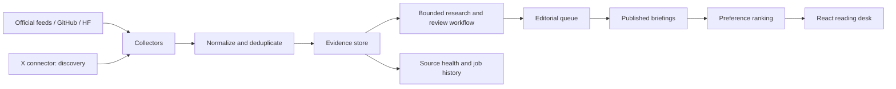

# Signaldesk: shipping blueprint

Updated 18 October 2026. Working name; portfolio project, not a commercial venture.

## Accepted implementation decisions

The cost and scope revisions are accepted. Development now uses hosted Experiential inference as the default test path because the development laptop is CPU-only. Ollama is opt-in; no automatic local inference runs. The selected model is `deepseek/deepseek-v4.1-flash-1017:free`, discovered using the user's provider account on 18 October. Every hosted model ID must explicitly end in `:free`; the adapter refuses ordinary paid IDs and stops if free access is unavailable. The provider documents this lane as refusing requests after its promotion is exhausted rather than charging credits. See [free-lane discovery](https://platform.experientiallabs.ai/docs/integrate).

The key lives only in the ignored backend `.env`. Public source excerpts and drafting/review prompts are sent to the selected provider. No credentials go into frontend bundles, Git, prompts, or application logs. Limits apply per manual run: three stories by default, at most two model requests per story, bounded output, and no application retries/fallback to a paid model. Usage traces record the provider-reported cost. Hosted inference is currently manual; the collection worker does not spend inference quota.

The user-approved scope remains: a simple editorial interface, explicit preferences, 8–12 curated comparison models, manual review of seven-day rechecks, and an initial separate 20-case AI evaluation set. Prioritize shipping those flows over additional infrastructure.

## Product promise

A personalized reading desk that answers: what changed in AI, why does it matter to me, and what evidence supports it? Start with models, MCP/agents, and GPU/CUDA. Give the user a useful daily briefing without requiring them to follow dozens of accounts.

The interview story is personal: keeping up with AI became exhausting, so I built a system that collects announcements, investigates selected claims, preserves sources, and ranks useful updates for each reader. Only claim shipped features and measured results on the resume.

## Decision on the cost proposal

Adopt the simpler scope and replaceable providers. Do not make launch depend on free X scraping, unlimited inference, or obtaining a free VM. Open-source application software and free hosted services are different things. The complete application should run locally without paid APIs; hosted providers are optional adapters. Model weights need their own license review.

| Proposal | Revised decision |
|---|---|
| Oracle A1 with 4 cores/24 GB | Current documentation lists 2 OCPUs/12 GB, plus 200 GB combined boot/block storage. Use only if capacity is available. Do not budget a production LLM on the same small CPU VM before measuring it. |
| Weekly keepalive protects Oracle | Remove this claim. Idle reclamation is based on multiple utilization measurements. Use external backups and a tested restore procedure; do not manufacture load. |
| Cloudflare Pages | Suitable for the static React build. Static requests are free/unlimited under the documented model; Functions and other services have separate limits. |
| twscrape as assured free primary | Treat it as a candidate connector requiring an authenticated trial, coverage measurement, and current access-policy review. No promise that burner accounts solve access or that personal use makes it permitted. |
| RSSHub as independent X fallback | Same upstream platform; failures can be correlated. Use official publisher feeds as the independent continuation path. |
| Official X costs $200/month | Outdated assumption. Current X docs describe usage-based credits; post reads are listed at $0.005/post. For illustration, 3,000 billable post reads would be $15, excluding other charges. Meter and cap access. |
| Free Groq/Gemini guarantees zero inference cost | Quotas depend on model/account and can change. Use queueing, caching, explicit limits, and no automatic transition to paid inference. |
| Delete all source HTML | Discard unnecessary raw HTML after extraction, but preserve short evidence excerpts, source URL, source date, fetch date, content hash, and versions. Public cards are short summaries with links, not mirrored articles. |
| Many monitoring services | Start with structured logs, source status, job history, and health checks. Error tracking is optional. |

Verified references: [Oracle](https://docs.oracle.com/en-us/iaas/Content/FreeTier/freetier_topic-Always_Free_Resources.htm), [X pricing](https://docs.x.com/x-api/getting-started/pricing), [Groq limits](https://console.groq.com/docs/rate-limits), [Gemini limits](https://ai.google.dev/gemini-api/docs/rate-limits), [Pages pricing](https://developers.cloudflare.com/pages/functions/pricing/), [R2 pricing](https://developers.cloudflare.com/r2/pricing/), [GitHub Actions billing](https://docs.github.com/en/billing/concepts/product-billing/github-actions).

## Budget policy

These are spending envelopes, not vendor quotations or promises of availability.

| Bucket | Development | Public pilot envelope/month |
|---|---|---|
| Hosting | Existing computer | ₹0 if free VM obtained; reserve ₹600–900 for a small paid VM, subject to an actual quote including taxes and IPv4 |
| Frontend | Local Vite | Static Pages within applicable free limits, or serve from the same VM |
| X | Disabled until a connector is evaluated | Optional ₹0–300; disable collection when its cap is reached |
| Inference | Local model when hardware permits | Free hosted quota first, optional explicitly enabled ₹0–300 cap |
| Database | SQLite for initial local slice | PostgreSQL on VM; no separate managed service required |
| Monitoring/storage | Logs and local excerpts | ₹0 target inside allowances; off-host backup is mandatory before launch |
| Domain | None | Optional; check actual purchase and renewal price |
| Contingency | None | ₹200–400 |

Aim for ₹1,000–2,000/month maximum, including taxes and domain allocation. If quoted costs exceed this, reduce X/inference volume or stay local until a viable host is found. Provider billing controls and application request budgets both matter; some provider budget alerts are not hard spending stops.

Start with roughly 20 tracked publishers/accounts, collect RSS hourly, and generate at most 10–20 selected briefings a day. This is an initial workload cap to measure, not a quota entitlement. Reader traffic serves cached briefings: one generation can serve many readers. No LLM call per scroll or per user.

## v1 scope

1. **Personal feed:** explicit interests, experience level, optional current model/tool, source-backed cards, search/filter, saved items. Guest mode works immediately; GitHub sign-in synchronizes preferences and saves.
2. **Modern reading experience:** mobile vertical cards, desktop grid, restrained motion, keyboard support. Original graphics and permitted source images; never fabricate benchmark charts. Add scroll snapping only if user testing supports it.
3. **Evidence detail:** what happened, why it matters, who benefits, limitations, original links, source dates, and last reviewed time. Distinguish announcement, vendor-reported benchmark, independently evaluated claim, and insufficient evidence. Editorial approval does not mean a benchmark was independently reproduced.
4. **Simple editorial pages:** draft list, evidence view, edit, approve/publish, reject, correction history. Authenticated admin role enforced on the server.
5. **Model comparison:** 8–12 manually curated models, dated context/pricing/license fields, and one comparison view. Only compare benchmark results with compatible task, dataset version, and evaluation conditions; otherwise show insufficient evidence. No universal best-model score.
6. **Rechecks:** after seven days, flag relevant published claims for manual review. Changes create revisions, never silently overwrite the original claim.
7. **Source status:** last fetch, last new item, newest source timestamp, errors, and measured account coverage. An old newest item can mean a quiet publisher, not automatically a broken feed.

Defer Reddit, video generation, native mobile apps, engagement-trained ranking, vector search, full analytics, billing, and automatic publication. Do not build a giant multi-agent organization to summarize a feed.

## Architecture

Frontend: React, TypeScript, Vite. Backend: Python, FastAPI, Pydantic, SQLAlchemy, PostgreSQL, Alembic migrations. Worker: a scheduled Python process with persisted jobs and bounded retries; PostgreSQL can hold the small queue, so Redis is unnecessary initially. Agent orchestration: LangGraph. Inference: Experiential's explicit free lane for development; Ollama is an optional offline adapter. Tests: pytest, browser journeys, and a separate versioned AI evaluation set. Packaging: containers and CI before public deployment.

### Agent responsibilities

- **Investigator:** extracts claims, chooses which permitted primary sources to inspect, and stops when evidence is adequate or its budget is exhausted. Tools are read-only, domain constrained, and unavailable for arbitrary commands.
- **Briefing writer:** produces structured JSON with sentence-level evidence references, uncertainty, and practical relevance.
- **Reviewer:** checks references and claim support, flags contradictions or missing evidence. It is an additional check, not an oracle. Programmatic schema/citation checks and human approval remain required.

Persist intermediate state and model/prompt versions. Permit at most two review loops, a bounded number of source fetches, and a fixed token budget per story. Treat source text as untrusted data; source instructions cannot alter tools or publishing permissions. If inference is unavailable, keep serving published briefings and visibly show pending drafts/source updates.

### X acceptance criteria

Evaluate one connector first against a manually checked list of selected public accounts. Record whether it misses posts, returns old timelines, loses pagination, or needs repeated authentication over a seven-day trial. Do not treat an HTTP 200 or a nonempty response as proof of completeness. Store post identifiers and links; enrich claims from official releases. Honor upstream limits and stop when access is denied.

Do not build automatic account/proxy rotation or CAPTCHA bypass. twscrape, RSSHub, syndication, and Nitter are experiments until their current behavior and permitted use are established. If no reliable automated option fits the budget, support admin submission of an X URL while the independently sourced feed continues. The UI must disclose limited X coverage.

Useful code references, not templates to copy: [twscrape](https://github.com/vladkens/twscrape), [RSSHub](https://github.com/DIYgod/RSSHub), [LangGraph](https://github.com/langchain-ai/langgraph), [Ollama](https://github.com/ollama/ollama). Verify licenses and current interfaces before integrating.

## Implementation sequence and release gates

| Stage | Work | Done when |
|---|---|---|
| 1. Real-data slice | Three official feeds, normalization, local database, responsive feed, preferences, saves, evidence details | Real data renders; repeated imports create no duplicates; unsupported claims stay unreviewed |
| 2. Reliable collection | GitHub/HF API adapters, source config, scheduling, timeouts/backoff, health signals, X trial | Jobs survive restart; source outages are visible; X coverage decision documented |
| 3. Evidence workflow | LangGraph investigation/writing/review, schema checks, provider adapter, budget caps, 20 curated eval cases | Unsupported claims are held; citations map to evidence; quota exhaustion degrades gracefully |
| 4. Product completion | GitHub OAuth, server sessions, admin role, approval/revisions, comparisons, recheck flag | Unauthorized publication fails; cross-user access fails; comparison labels are supported |
| 5. Public pilot | PostgreSQL migrations, containers, HTTPS, backups, deployment, smoke tests | Fresh install and restore succeed; daily jobs run; external phone/desktop can use the app |
| 6. Portfolio release | Short demo, architecture README, failure examples, measured cost and quality, tagged release | A co-founder can try it without setup and understand the engineering choices in minutes |

Planning estimate: 3–4 focused weeks, depending on available time and access to X/hosting. This is a sequence, not a guaranteed delivery date. Deploy a read-only staging slice before stage 4; keep admin mutation endpoints private until their authorization tests pass.

Start the AI evaluation set with 20 manually checked cases: announcements, misleading benchmarks, duplicates, stale posts, conflicting reports, missing evidence, and prompt injection. Report support rate, incorrect attribution, false merge rate, latency, and tokens/cost per accepted briefing. Expand after pilot feedback. These 20 cases are separate from software unit tests and are not enough to claim general accuracy.

## Publishing route

1. Prepare a public GitHub repository with a license for original code, reproducible setup, screenshots, and a clear status table. Do not publish source cookies, keys, databases, or third-party full articles.
2. Build and test frontend/API; test PostgreSQL migrations and failure recovery. Choose ARM-compatible images if using A1.
3. Try one Oracle provisioning session. If capacity is unavailable, use the paid-VM envelope after confirming a real price; do not spend days cycling regions.
4. Keep Postgres private. Serve the application and API under one HTTPS origin where practical. Pages can host the static frontend, but authenticated `/api` routing needs a tested proxy and any associated service quota. An easier initial deployment is static assets plus API behind Caddy on the same VM. Avoid fragile cross-site cookie assumptions between unrelated free domains.
5. Configure server-only secrets, OAuth callback, admin allowlist, secure cookies, CSRF protection, rate limits, and restrictive source-fetch permissions. Guest reading remains available.
6. Add off-host database backups, verify an actual restore, then schedule collection and editorial rechecks. Cloudflare proxying still requires a correctly configured HTTPS origin.
7. Run desktop/mobile smoke tests, review 10–20 briefings, collect a week of pipeline measurements, then tag v1.0 and record a 90-second demo.

No accounts, paid services, cloud resources, or public repository have been created by this initial build.

## Current implementation status

Stage 1 is implemented as a local source preview. Three RSS/Atom collectors fetched 106 entries on 18 October 2026. Topic labels currently come from each publisher's configured category, so they are broad rather than per-article AI classifications. The API serves publisher excerpts; it does not claim they are fact-checked. Preferences and bookmarks persist only in the browser. SQLite is the tested local store; production PostgreSQL validation is pending.

The local preview has durable hourly collection jobs, exclusive leases, interrupted-job recovery, exponential backoff, Retry-After handling, worker heartbeats, and source timing. A LangGraph workflow prepares evidence, writes a structured draft, checks exact citations, and performs model review when citations pass. Intermediate results and tokens are persisted; failed generations can be explicitly retried and interrupted generations become recoverable after five minutes. Drafts with changed source evidence are marked as older versions. The Source desk exposes the evidence queue and starts one bounded draft at a time in the local preview. No workflow can publish.

Two initial local Qwen smoke-test drafts were held for quotations absent from the evidence. This is not a model-quality evaluation. Hosted integration and regression validation are recorded in README.md.

Stage 2 now includes GitHub release collectors for Transformers, llama.cpp, and the MCP Python SDK, plus a Hugging Face Hub collector for 40 text-generation models. The Models page compares published model metadata and keeps hourly download snapshots for 24-hour and 7-day growth. The public models endpoint currently sorts by total downloads; the application reports growth only after it has enough historical observations. Popularity is a discovery signal, never a quality score. Model-card licenses are shown when supplied; missing details stay labeled. GitHub pre-releases are included and explicitly labeled.

The evaluation fixture now contains 20 synthetic cases and a free-only runner that records a versioned report. Its first complete run on 18 October 2026 got 20/20 expected dispositions and 45% literal required-phrase coverage; an exact phrase check flagged the prompt-injection case even though the response explicitly treated the text as untrusted. This smoke result is not an accuracy or safety claim. The Source desk includes loopback-only manual X post capture: a user supplies a public post URL and its text, stored as unverified evidence. It does not sign into X or scrape timelines. Local `.env` enables this preview; Compose disables it until authentication exists. The app has a Docker Compose package for PostgreSQL, the API, worker, and static site, bound to loopback. Compose configuration parses, while image builds await a running Docker engine.

Still outside the local portfolio release: evaluate permitted automated X access, full-article research tools, a source-investigation agent, reviewed reference annotations for the evaluation fixture, editorial accounts and approval/publishing, server-synced saves, curated benchmark comparisons, PostgreSQL runtime validation, and a public URL. Alembic's initial schema revision is applied by the container API before startup, with safe baseline stamping for complete older schemas. A fresh SQLite migration and repeat-upgrade were validated; PostgreSQL and Docker image runtime checks need an available Docker host. Stage 2 is partially implemented; stage 3's evidence workflow is a local preview with an early smoke evaluation and no reviewed factuality scores. The software regression tests are separate from that evaluation set. Public exposure remains blocked on authentication, authorization, backups, production secrets, and a tested HTTPS origin.
