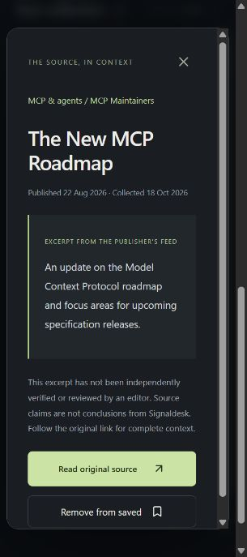

# Signaldesk

A personal AI reading desk. This first build collects real publisher feeds and provides topic preferences, search, saved items, original-source details, and collection status.

**Status: local portfolio demo plus a scheduled, read-only GitHub Pages release path.** The app collects public sources, prepares cited drafts, and keeps every draft in human review. The public build contains only source/model snapshots; private drafts and model traces stay local. Read [BLUEPRINT.md](BLUEPRINT.md) for scope and [DEPLOYMENT.md](DEPLOYMENT.md) for setup and release limits.



## Run locally

Prerequisites: Python 3.11+, uv, and Node.js 22.12+ or 24. Run from this repository directory:

```powershell
uv sync --frozen --group dev
uv run python -m backend.migrate
uv run python -m backend.ingest
uv run uvicorn backend.main:create_app --factory --host 127.0.0.1 --port 8787
```

In a second terminal:

```powershell
cd frontend
npm ci
npm run dev
```

Open the localhost URL printed by Vite (normally http://127.0.0.1:5173). Vite proxies `/api` to the local API. The server is deliberately bound to loopback; this is a development setup.

## Local container preview

The Compose setup runs PostgreSQL, the API, the hourly worker, and the static frontend behind Caddy in read-only public-demo mode. Copy `.env.example` to `.env`, then set a long random alphanumeric local PostgreSQL password. `.env` is ignored by Git. The web port binds to `127.0.0.1:8080`; this setup is a local preview, not a public deployment. Use the direct local API commands above when testing draft generation.

```powershell
docker compose up --build
```

Open http://127.0.0.1:8080. The API applies Alembic migrations before serving. Stop with Ctrl+C, then `docker compose down`. The named PostgreSQL volume remains for the next run. The static public build refreshes source/model snapshots every six hours; the full API stack is still not intended for public exposure. See [DEPLOYMENT.md](DEPLOYMENT.md).

Optional manual single-source collection:

```powershell
uv run python -m backend.ingest --source mcp
```

## Scheduled collection and draft review

Run the collection worker in a separate terminal. It checks persisted due times every 30 seconds and collects each source hourly; failures back off. Restarting preserves the schedule, and expired leases recover interrupted jobs. Stop it with Ctrl+C. This does not install an OS service or start inference.

```powershell
uv run python -m backend.worker
# For one due-job cycle only:
uv run python -m backend.worker --once
```

Use the Source desk to inspect worker heartbeats, collection timing, and the evidence queue. A recent heartbeat means the worker was observed recently, not an uptime guarantee.

Prepare evidence without any model or hosted request:

```powershell
uv run python -m backend.briefing --provider evidence --limit 10
```

Hosted testing uses Experiential, with the key stored in the ignored root `.env` (see `.env.example`). The provider adapter contacts only the fixed Experiential API origin, refuses model IDs without `:free`, checks availability, and has no automatic retries or paid fallback. It requires a zero reported usage cost. A quota/auth error stops the batch. Do not put credentials in frontend environment variables.

```powershell
uv run python -m backend.briefing --provider experiential --limit 3
# Explicit retry of failed requests, still using the free-only model:
uv run python -m backend.briefing --provider experiential --limit 1 --retry-failed
```

Run the separate synthetic evaluation set (up to 20 free-only model calls). It writes a report under the ignored `evals/runs/` folder and records per-case output, token usage, fixture hash, and aggregate scores. Start with `--limit 1`; no paid fallback is available.

```powershell
uv run python -m backend.evaluate --limit 1
# Full 20-case run:
uv run python -m backend.evaluate --limit 20
```

Each story uses at most two inference calls; the default batch has three stories. Model output is schema checked, quotations must match stored evidence, and a separate model review checks support. Even a successful review leaves the draft awaiting human review. The tiny local Qwen test produced two held drafts; its output is not a factuality baseline. To opt into local inference later, use `--provider ollama --model qwen3:0.6b`; it is never an automatic fallback.

Per-stage evidence, usage, and results persist in SQLite. Repeated runs reuse completed work. Interrupted drafts can be reclaimed after five minutes; explicit failed retries restart that draft. This is restart recovery, not token-level continuation of a model request. The generation control is intended for the local preview; authenticated roles are required before public deployment.

The default database is `data/signaldesk.db`, excluded from Git. `DATABASE_URL` can override it. PostgreSQL uses Alembic migrations; the existing local SQLite preview remains self-initializing. Do not expose this development server publicly.

## What works

- RSS/Atom from Hugging Face, NVIDIA Developer, and the MCP maintainers, plus official GitHub releases for Transformers, llama.cpp, and the MCP Python SDK.
- A Hugging Face Hub collector for the top 40 text-generation repositories, retaining hourly download snapshots for 24-hour and 7-day growth signals.
- A model discovery and comparison page for task, license, downloads, likes, last update, and observed download growth. Popularity is labeled separately from model quality; matched benchmarks are not inferred.
- A loopback-only manual X capture form that stores the pasted post text and link as an unverified evidence item. It requires `SIGNALDESK_LOCAL_X_INTAKE=true`; it does not log into X, fetch timelines, or scrape posts. Compose keeps this intake disabled until an authenticated public workflow exists.
- Bounded response sizes, XML entity/DTD rejection, HTTPS publisher link validation, and text-only excerpts.
- For the two newest RSS entries per source with a very short feed summary, attempts same-host, redirect-disabled article retrieval and stores only a bounded text excerpt; it does not retain HTML or the full article.
- Stable identifiers, idempotent ingestion, retained evidence versions when title/excerpt changes.
- Responsive feed, topic filters, search, detail dialogs, source links, browser-local bookmarks and interests.
- Source status, durable collection schedules, backoff, and worker heartbeat.
- LangGraph draft/review flow with evidence references, held/error states, generation caching, revision detection, and an in-app local action to draft one next unprocessed signal. Each click is capped to one story and two model calls; results remain unpublished for human review.
- Free-only hosted inference adapter plus optional Ollama. Source text with too little evidence is held before inference.
- A sanitized static snapshot for GitHub Pages; scheduled refreshes contain only publisher items and model metadata, never private drafts or model traces. A compact public download-count history preserves 24-hour and 7-day discovery signals across stateless GitHub runners.

Topic tags currently reflect publisher categories. A NVIDIA article about agents may still appear under GPU/CUDA. Per-article classification is a later workflow step.

## Deliberate release limits

Automated X collection, full-article research tools, editorial approval/publishing, authentication, and multi-user data are outside this release. The scheduled Pages workflow publishes a sanitized snapshot; the full API stack is not publicly hosted. The 20-case synthetic fixture has a free-lane evaluation runner; one smoke run scored 20/20 expected dispositions and 45% literal phrase coverage, with rubric limitations documented in `evals/README.md`. Compose configuration and migrations are validated, but Docker image builds and PostgreSQL runtime still need a running Docker engine. Reading and evidence preparation work without an inference key. Some publisher feeds supply no excerpt; those records need more evidence before drafting.

## Verify

The current regression suite passes **46 tests**, including a populated legacy-database migration, repeat-upgrade, public-demo privacy checks, and model-history calculations. Both the regular frontend build and the static demo build pass. A live Experiential free-lane draft passed exact-citation checks and model review, ending in `needs_review`. Its successful writing and review calls each reported `usage.cost = 0`; traces recorded 457 and 120 completion tokens respectively. An earlier review was truncated by its smaller token allowance and was explicitly retried with a bounded larger allowance. This is one integration smoke test, not a general accuracy result.

Browser verification confirmed the live queue, source schedules/heartbeat, status filtering, draft expansion, original excerpt, citations, model name, and limitations. The backend key was checked to be absent from Git-visible files and the frontend build. The collector has been launched locally; it runs only while that process and laptop remain on.

```powershell
uv run pytest -q
cd frontend
npm run build
```

Initial live ingestion collected 40 Hugging Face, 40 NVIDIA, and 26 MCP items. Software tests cover parsing, unsafe links/XML, idempotency, revisions, API limits, worker leases/retries, citation rejection, and model failure. They are not AI factuality evaluations. Provider tests use a mock transport so CI does not require a key or spend quota.

A second live collection added zero duplicates. Browser checks verified interest-based ordering, saving an article, persistence after reload, evidence details, and source status in the narrow in-app viewport. A CI workflow is included; it has not run on GitHub because this checkout has no remote. Docker image and PostgreSQL runtime checks require a host with Docker available.

## Layout

```text
backend/          FastAPI, source registry, collector, SQLAlchemy storage
frontend/         React + TypeScript + Vite
tests/            Ingestion and API regression tests
BLUEPRINT.md      Scope, cost decisions, architecture, publishing gates
DEPLOYMENT.md     Local run, static demo, and public-hosting limits
SECURITY.md       Security boundary and vulnerability reporting
migrations/       Alembic revisions for PostgreSQL
evals/            Synthetic AI evaluation set and known limitations
```

Publisher content remains attributed to its source. Local excerpts are evidence for reading and investigation, not a license to republish complete articles. Application code is licensed under MIT; publisher content keeps its own rights and terms.
